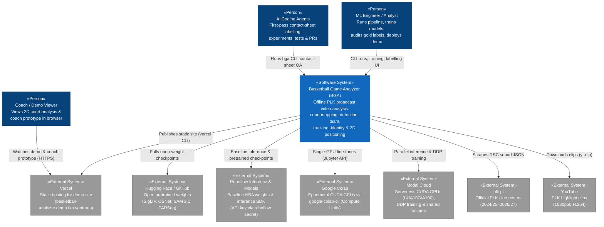
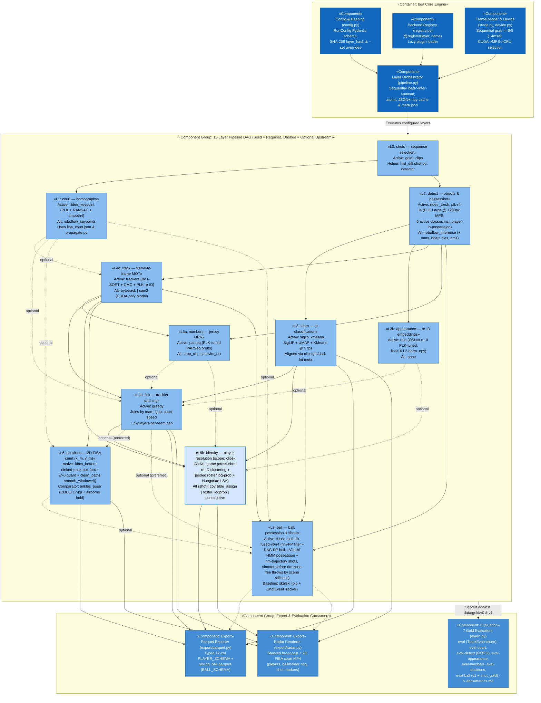
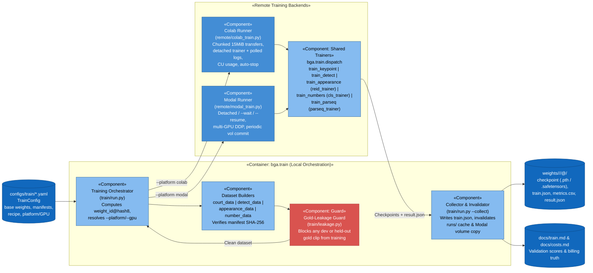
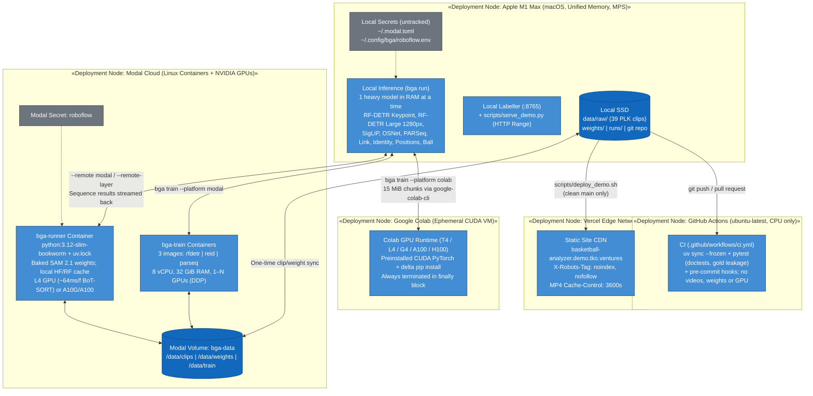
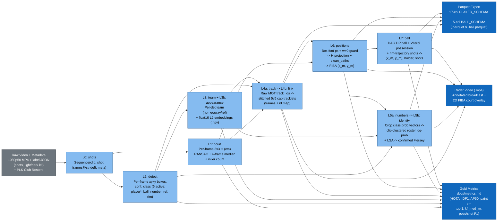

# Architecture — C4 Visual Views

*Companion diagrams to the canonical [`docs/architecture.md`](architecture.md) (M0–M9 shipped, M10 next, as of 2026-11-24).*

> **Maintenance rule:** [`docs/architecture.md`](architecture.md) is the canonical architecture document. Whenever `docs/architecture.md` changes (active stack, layer DAG/contracts, execution/eval/training mechanics, compute topology, or major subsystems), update this file in the same change so the C4 views stay in sync.

This document presents the current solution from six complementary angles:

1. [C4 Level 1 — System Context](#1-c4-level-1--system-context)
2. [C4 Level 2 — Container Diagram](#2-c4-level-2--container-diagram)
3. [C4 Level 3A — Component Diagram: Pipeline Engine & All 11 Layers (L0–L7)](#3-c4-level-3a--component-diagram-pipeline-engine--all-11-layers-l0l7)
4. [C4 Level 3B — Component Diagram: Training, Provenance & Gold-Leakage Guard](#4-c4-level-3b--component-diagram-training-provenance--gold-leakage-guard)
5. [Deployment & Compute Topology](#5-deployment--compute-topology)
6. [Dynamic / Data-Contract View](#6-dynamic--data-contract-view)

---

## 1. C4 Level 1 — System Context

Actors and external systems surrounding `basketball-game-analyzer`.

---

## 2. C4 Level 2 — Container Diagram

Runnable applications, cloud workers, and persistent data stores across the local Mac and cloud platforms.

```mermaid
flowchart TB
    classDef person fill:#08427B,stroke:#052E56,color:#FFFFFF
    classDef container fill:#438DD5,stroke:#2E6295,color:#FFFFFF
    classDef cloud fill:#2E6295,stroke:#1B3F63,color:#FFFFFF
    classDef store fill:#1168BD,stroke:#0B4884,color:#FFFFFF
    classDef external fill:#999999,stroke:#6B6B6B,color:#FFFFFF

    user["«Person»\nAnalyst / Agent"]:::person
    viewer["«Person»\nDemo Viewer"]:::person

    subgraph local["«System Boundary: Local Workstation — Apple M1 Max (MPS)»"]
        cli["«Container: CLI & Pipeline»\nbga CLI (src/bga/cli.py)\nPython 3.12, Typer, PyTorch MPS,\nOpenCV, PyArrow, Pydantic"]:::container

        labeler["«Container: Local Web App»\nLabeller Server (tools/labeler/server.py)\nStdlib ThreadingHTTPServer :8765\nPages: /, /court, /boxes, /numbers, /events, /holders, /shotgold"]:::container

        scripts["«Container: Batch Utilities»\nData, QA & Demo Scripts (scripts/)\nClip fetch, roster fetch, contact sheets,\nSAM2 prefill, demo/coach builders"]:::container

        gitdata[("«Data Store: Git-Tracked»\nConfigs, Labels, Rosters, Gold & Docs\nconfigs/, data/labels/, data/rosters/,\ndata/gold/v0..v1, data/fixtures/, docs/")]:::store

        localstore[("«Data Store: Local Gitignored»\nMedia, Weights & Stage Cache\ndata/raw/*.mp4, weights/<id>/,\nruns/<clip>/<layer>/<backend>@<hash8>/")]:::store
    end

    subgraph modal_cloud["«System Boundary: Modal Cloud»"]
        modal_run["«Container: Modal App»\nbga-runner (modal_runner.py)\nParallel per-sequence inference\n(CUDA-only SAM2 or --remote-layer)"]:::cloud

        modal_trn["«Container: Modal App»\nbga-train (modal_train.py)\nSingle-GPU & multi-GPU DDP\nfine-tuning containers"]:::cloud

        modal_vol[("«Data Store: Modal Volume»\nbga-data Volume\n/data/clips, /data/weights,\n/data/train/<weight_id>/")]:::store
    end

    subgraph colab_cloud["«System Boundary: Google Colab»"]
        colab_vm["«Container: Ephemeral GPU VM»\nColab Runtime (colab_train.py)\nChunked upload/download over\nJupyter Contents API; auto-teardown"]:::cloud
    end

    subgraph vercel_edge["«System Boundary: Vercel Edge»"]
        demo_site["«Container: Static Web App»\nDemo & Coach Site\n/ (analysis), /coach/ (synthetic),\n/roadmap/ (milestones)"]:::cloud
    end

    ext_sources["«External Systems»\nYouTube, plk.pl, Roboflow, HF Hub"]:::external

    user -->|"bga run / eval* / train / export / radar"| cli
    user -->|"Labels tracks, court, boxes, numbers (HTTP)"| labeler
    user -->|"Prepares data, builds & deploys demo"| scripts
    viewer -->|"HTTPS"| demo_site

    cli -->|"Reads configs, rosters, gold; logs metrics/costs"| gitdata
    cli <-->|"Reads clips/weights; writes atomic JSON+.npy/Parquet/MP4"| localstore
    labeler <-->|"Reads clips; writes label JSON, .mot.txt, .csv"| gitdata
    labeler -->|"Decodes frames (OpenCV)"| localstore
    scripts <-->|"Reads/writes labels, manifests, rosters"| gitdata
    scripts <-->|"Reads/writes raw clips & demo build"| localstore
    scripts -->|"Downloads clips & rosters"| ext_sources
    scripts -->|"Deploys runs/demo/web (deploy_demo.sh)"| demo_site

    cli -->|"Spawns .map() calls; streams outputs"| modal_run
    cli -->|"Spawns detached/waited training jobs"| modal_trn
    cli -->|"Syncs clips, datasets & weights"| modal_vol
    modal_run <-->|"Reads clips & weights"| modal_vol
    modal_trn <-->|"Reads datasets; commits checkpoints"| modal_vol

    cli -->|"Uploads bga+dataset; runs dispatch; pulls weights"| colab_vm
    modal_run -->|"Pulls pretrained models"| ext_sources
    modal_trn -->|"Pulls pretrained base weights"| ext_sources
    colab_vm -->|"Pulls pretrained base weights"| ext_sources
```

---

## 3. C4 Level 3A — Component Diagram: Pipeline Engine & All 11 Layers (L0–L7)

Internal orchestration of `src/bga/`, the fixed `bga.config.LAYERS` DAG (solid = required upstream, dashed = optional upstream), active leading backends vs. registered alternatives, and downstream consumers.

---

## 4. C4 Level 3B — Component Diagram: Training, Provenance & Gold-Leakage Guard

Dataset preparation, gold-leakage enforcement, Colab/Modal training dispatch, and provenance-backed collection.

---

## 5. Deployment & Compute Topology

Physical execution nodes, memory/cost boundaries, container images, volumes, and secret locations.

---

## 6. Dynamic / Data-Contract View

End-to-end transformation of a broadcast sequence from raw 1080p50 MP4 to typed Parquet, radar video, and gold metrics.

---

## Layer & Backend Summary

Exact backend contracts live in `src/bga/<layer>/base.py`; run `bga backends` for the live registry. Optional upstreams are in italics (`OPTIONAL_UPSTREAM` and `OPTIONAL_BY_LAYER` in `src/bga/config.py`).

| Layer | Package | Upstream | Active Leading Backend | Registered Alternatives |
|---|---|---|---|---|
| **L0 `shots`** | `src/bga/ingest/` | *(none)* | `gold` / `clips` | `shot_gold` |
| **L1 `court`** | `src/bga/court/` | `shots` | `rfdetr_keypoint` | `roboflow_keypoints` |
| **L2 `detect`** | `src/bga/detect/` | `shots` | `rfdetr_torch` | `roboflow_inference` |
| **L3 `team`** | `src/bga/team/` | `detect` | `siglip_kmeans` | — |
| **L3b `appearance`** | `src/bga/appearance/` | `detect` | `reid` | `none` |
| **L4a `track`** | `src/bga/track/` | `detect`, *(`court`)* | `trackers` | `bytetrack`, `sam2` |
| **L4b `link`** | `src/bga/link/` | `track`, `team`, *(`appearance`, `court`, `numbers`)* | `greedy` | — |
| **L5a `numbers`** | `src/bga/numbers/` | `detect`, `track` | `parseq` | `crop_cls`, `smolvlm_ocr` |
| **L5b `identity`** | `src/bga/identity/` | `link`, `track`, `team`, *(`numbers`, `appearance`)* | `game` *(clip-scoped)* | `covisible_assign`, `roster_logprob`, `consecutive` |
| **L6 `positions`** | `src/bga/positions/` | `track`, *(`link`, `court`)* | `bbox_bottom` | `ankles_pose` *(comparator)* |
| **L7 `ball`** | `src/bga/ball/` | `detect`, `track`, `team`, *(`link`, `court`, `positions`)* | `fused` | `skalski` *(baseline)* |
